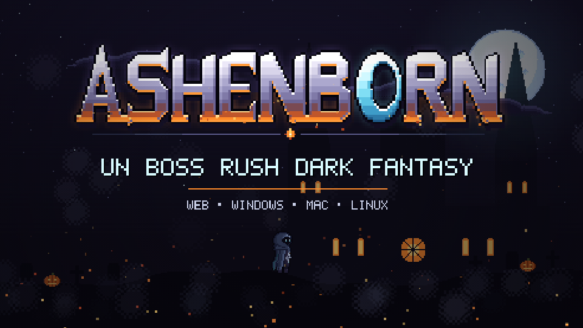
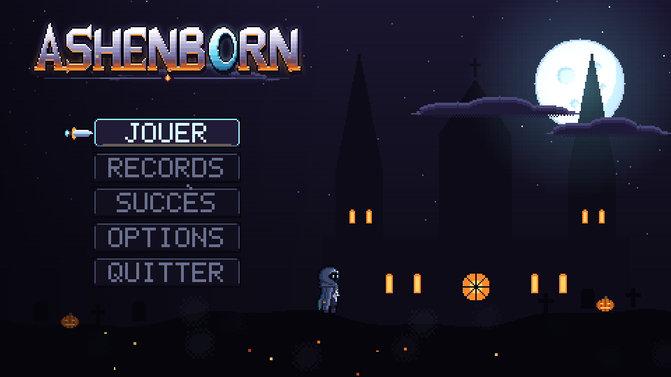
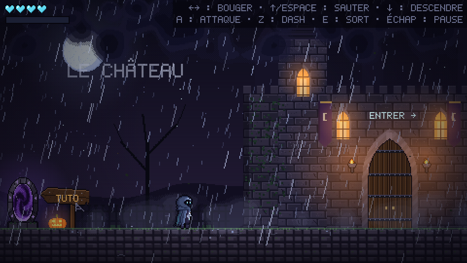
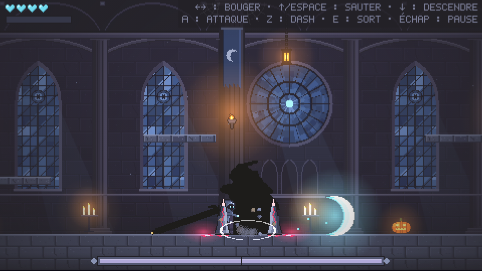
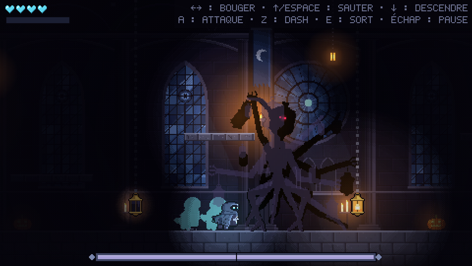
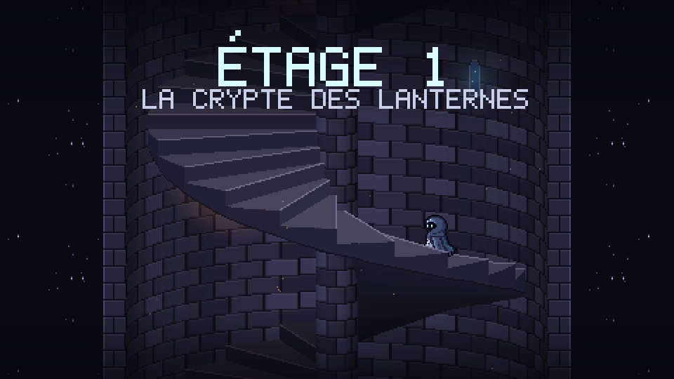
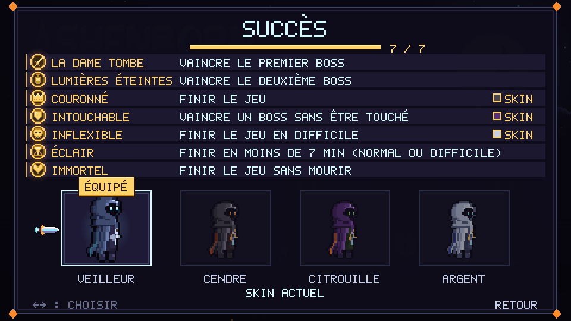

<p align="center">
  
</p>

<p align="center">
  <b>Boss rush dark fantasy pour Halloween : gravis un château maudit, étage après étage, et abats ses gardiens.</b><br>
  <i>A dark fantasy Halloween boss rush: climb a cursed castle floor by floor and bring down its guardians.</i>
</p>

<p align="center">
  
  
  
  
  
</p>

---

La nuit d'Halloween, un château maudit se dresse dans la tempête. À chaque étage, un boss garde l'escalier. Monte, affronte-les un par un, et va chercher la couronne au sommet.

Jeu créé pour l'**Oddward Jam #1**, dont la consigne imposait des **combats de boss** (barre de vie nommée, salles de boss). Une partie dure environ 5 minutes.

| | |
|:---:|:---:|
|  |  |
|  |  |
|  |  |

## Fonctionnalités

- **Combats de boss nerveux et lisibles** : chaque attaque est télégraphiée, le boss passe en deuxième phase à mi-vie (rugissement, nouveaux patterns, plus de vitesse), barre de vie nommée.
- **Un château en étages** : la nef, la crypte des lanternes plongée dans l'obscurité… et un dernier étage qu'on garde secret. Chaque victoire ouvre l'escalier de la tour.
- **Un héros vif** : saut variable, coyote time, dash invincible, combo de trois coups aux dagues, sort « Éclat lunaire » qui se charge en frappant, amélioration à choisir en cours de route.
- **Trois difficultés** : VRAIMENT FACILE (mode histoire : plus de cœurs, dégâts doublés), NORMAL (sauvegarde au début de chaque boss), DIFFICILE (aucune sauvegarde). La difficulté monte d'un étage à l'autre.
- **Tutoriel facultatif** par le portail devant le château.
- **Speedrun** : chrono affichable (figé en pause et au tuto), temps à la chute de chaque boss, top 5 par difficulté dans le menu RECORDS.
- **7 succès et 3 skins du héros** à débloquer (CENDRE, CITROUILLE, ARGENT), avec un écran SUCCÈS dédié.
- **Options** : volume général, musique et effets, plein écran, touches réassignables, lettres AZERTY ou QWERTY.

## Commandes

| Action | AZERTY | QWERTY |
|---|---|---|
| Se déplacer | ← → | ← → |
| Sauter (maintenir pour sauter plus haut) | ↑ ou Espace | ↑ ou Espace |
| Descendre d'une plateforme | ↓ | ↓ |
| Attaque (combo de 3 coups) | A | Q |
| Dash (esquive, invincible) | Z | W |
| Sort « Éclat lunaire » (mana pleine) | E | E |
| Pause | Échap ou P | Esc ou P |
| Couper la musique | M | M |
| Menus | flèches + Entrée, ou souris | idem |

Les touches sont lues par **position physique** : les deux colonnes désignent les mêmes touches du clavier. Tout se réassigne dans **OPTIONS > TOUCHES**.

## Jouer

Le jeu tourne entièrement hors ligne, sans aucun appel réseau.

```bash
bun install
bun run build      # dist/index.html : s'ouvre directement dans le navigateur (file://)
bun run zip        # exports/ashenborn-web.zip
bun run desktop    # exports/ashenborn-linux.tar.gz, ashenborn-windows.zip, ashenborn-mac.zip
```

Les versions bureau embarquent Electron (téléchargé dans `.electron/` au premier lancement), s'ouvrent en fenêtre 1280×720 au ratio 16:9 et bloquent tout accès réseau. Lanceurs : `./ashenborn` (Linux), `Ashenborn.exe` (Windows), `Ashenborn.app` (macOS Apple Silicon).

## Développement

Prérequis : [Bun](https://bun.sh), qui sert de gestionnaire de paquets et lance Vite.

| Commande | Effet |
|---|---|
| `bun run dev` | Serveur de dev avec rechargement à chaud sur http://localhost:5173 |
| `bun run check` | Vérification des types (`tsc --noEmit`) |
| `bun run build` | Build de production dans `dist/` |

Outils réservés au mode dev (absents des exports) :

| Raccourci | Effet |
|---|---|
| `#Boss1`, `#Boss2`, `#Boss3`, `#Test`, `#Outside`… dans l'URL | Démarre directement sur cette scène |
| `#Escalier` | Montée de la tour en boucle |
| `#Musique` | Juke-box : chaque piste jouée seule |
| `#Succes` | Débloque tous les succès |
| `?viewer` | Visualiseur d'animations des boss et du joueur |
| `F1` / `F2` | Boss à 1 PV / joueur invincible |
| Bouton TESTER BOSS du menu | Lance n'importe quel combat |
| `window.game` | Instance Phaser dans la console |

## Sous le capot

- **Phaser 3.90 + TypeScript**, physique Arcade, rendu en 480×270 agrandi sans flou (×4 en 1920×1080).
- **Aucun fichier image ni son** : tout le pixel art est dessiné par le code (canvas), et toute la musique et les bruitages sont synthétisés en WebAudio (harpe et luth Karplus-Strong, cloches, chœur, orgue, chiptune, réverbération de nef). Le détail des pistes est dans [MUSIQUES.md](MUSIQUES.md).
- **Boss pilotés par les données** : un boss générique (télégraphe → actif → récupération, sélection pondérée des patterns, phase 2 à 50 %) et un fichier de données par boss.
- **Sauvegardes locales** (records, succès, skin, options) dans le `localStorage`, toujours protégées : le jeu marche aussi là où le stockage est bloqué.

```
src/
├── main.ts            configuration Phaser, liste des scènes
├── config.ts          toutes les valeurs réglables (joueur, boss, difficulté, audio)
├── floors.ts          étages du château, état de la partie, points de reprise
├── speedrun.ts        chrono et records
├── achievements.ts    succès et skins
├── input.ts           clavier par position physique, réassignation
├── entities/          joueur, boss générique, portail
├── bosses/            un fichier de données et de patterns par boss
├── scenes/            menu, château, tuto, salles de boss, tour, fin, pause, game over
├── ui/                HUD, barre de boss, annonceur, menus, options, cartes d'amélioration
├── art/               génération des textures (héros, boss, décors, logo, police bitmap)
├── audio/             moteur WebAudio, instruments, bruitages, séquenceur et pistes
└── viewer/            outils de dev (exclus du build)
scripts/               export web (zip) et exports bureau (Electron)
```
